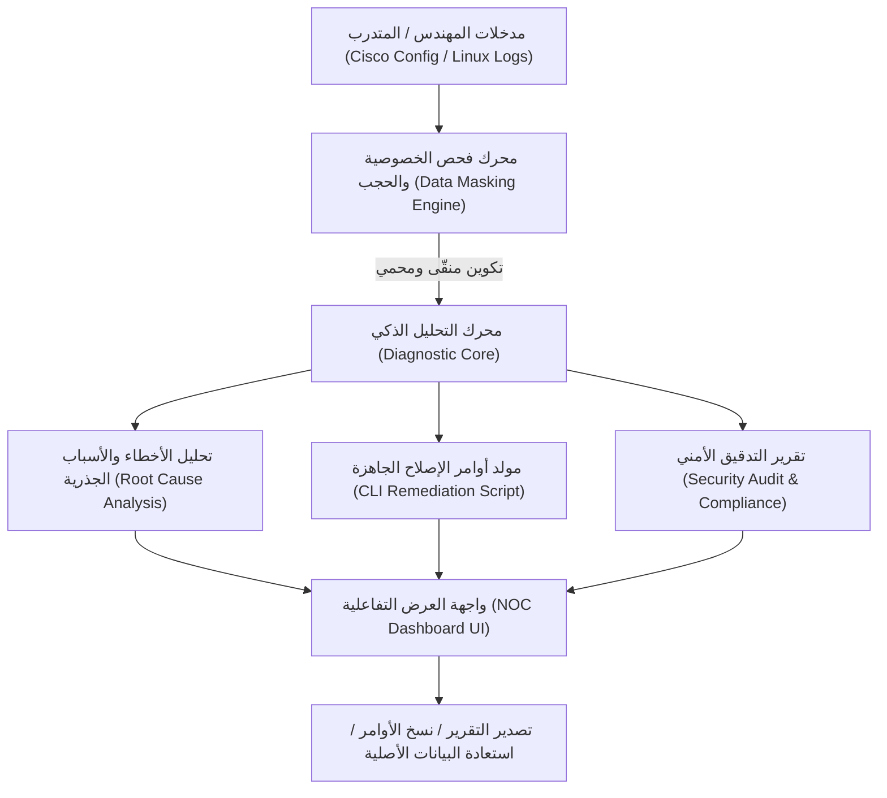

# ذاكرة المشروع (Project Memory)
## مساعد الشبكات الذكي | NetTroubleshooter AI
**المسار:** مسار الأنظمة والاتصالات (Systems & Telecommunications Track)  
**الفعالية:** هاكاثون رُبّان 2026 (Robban Hackathon 2026)  
**تاريخ التوثيق:** نوفمبر 2026  
**حالة المشروع:** مرحلة التخطيط وبناء النموذج الأولي (MVP Specification)

---

## 1. بطاقة تعريف المشروع (Project Card)

| العنصر | الوصف |
| :--- | :--- |
| **اسم المشروع** | **مساعد الشبكات الذكي (NetTroubleshooter AI)** |
| **الشعار/الهدف** | بيئة تشخيص وتدريب ذكية تجمع بين كفاءة استكشاف الأعطال وحماية خصوصية بيانات البنية التحتية. |
| **المسار المستهدف** | الأنظمة والاتصالات - هاكاثون رُبّان 2026 |
| **المستخدمون المستهدفون** | مهندسو مراكز عمليات الشبكة (NOC)، مسؤولو أنظمة Linux، متدربو وطلاب هندسة الشبكات والاتصالات. |
| **طبيعة التسليم الأولي (MVP)** | تطبيق ويب تفاعلي ذو صفحة واحدة (`index.html`) خفيف وسريع يعمل دون تعقيدات بنية تحتية. |

---

## 2. المشكلة والحل المقترح (Problem & Solution)

### المشكلة (The Problem):
1. **التعقيد وبطء استكشاف الأعطال (Troubleshooting Latency):** تتطلب أعطال إعدادات Cisco وأنظمة اتصالات Linux ساعات من التحليل اليدوي لمراجعة ملفات التكوين (Configs) وسجلات النظام (Logs).
2. **مخاطر الخصوصية وتسريب الأسرار (Data Privacy & Secret Leakage):** عند لجوء المهندسين إلى أدوات الذكاء الاصطناعي العامة لحل المشكلات، يتم تسريب بيانات حساسة مثل كلمات المرور المشفرة (Secrets/Hashes)، وعناوين IP الداخلية، ومفاتيح التشفير، وسلاسل SNMP Communities.
3. **الفجوة المعرفية للمتدربين (Knowledge Gap):** يفتقر المهندسون المبتدئون إلى التفسير السياقي والخطوات الإجرائية الآمنة للإصلاح وفق أفضل الممارسات المعتمدة (Hardening Standards & CIS Benchmarks).

### الحل (NetTroubleshooter AI):
منصة ويب ذكية تعالج هذه المعضلات عبر خط إنتاج متكامل:
- **حجب البيانات الحساسة فورياً (Client-Side Data Masking):** استبدال الأسرار وعناوين الشبكة الحساسة ببيانات وهمية قبل إرسالها للتحليل.
- **محرك تحليل هجين (Hybrid Diagnostic Engine):** فحص إعدادات Cisco IOS/NX-OS وبيئات Linux (Netplan, systemd-resolved, iptables/ufw, routing) وربط الأعراض بالأسباب الجذرية.
- **توليد أوامر المعالجة الفورية (Remediation Playbooks):** توليد أوامر CLI دقيقة وقابلة للتنفيذ المباشر مع شرح أثر كل أمر.
- **تقرير تدقيق أمني وفني (Security & Best-Practices Audit):** فحص الثغرات التكوينية وإصدار تقرير شامل جاهز للطباعة أو المشاركة.

---

## 3. الهيكل التقني للنموذج الأولي (MVP Architecture)

تم اختيار تصميم **Single-Page Application (SPA)** بملف مستقل `index.html` لتحقيق أقصى درجات السرعة، وسهولة التقييم في الهاكاثون، والعمل الموثوق (Zero-deployment barrier):



### المكونات الأساسية في `index.html`:
1. **واجهة المستخدم (UI/UX - NOC Theme):**
   - تصميم داكن عصري (Dark Mode) مستوحى من لوحات مراكز العمليات (NOC/SOC).
   - مكتبة التنسيق: Tailwind CSS عبر CDN مع خط تجوالي/عربي ملائم لواجهات الاستخدام الفنية.
   - تبويبات سريعة للتنقل: (إدخال التكوين | الفحص والحجب | التشخيص والأوامر | التقرير الأمني).

2. **وحدة حجب البيانات الحساسة (Data Masking Module):**
   - تعمل محلياً بالكامل على متصفح العميل (Client-Side Regex & Rule-Sets).
   - كشف وحجب:
     - كلمات المرور: `enable secret`, `password 7`, `hash`, `pre-shared-key`
     - عناوين الشبكة: IPv4/IPv6 الحساسة والـ Subnets
     - سلاسل الاتصال: `snmp-server community`, `TACACS/RADIUS keys`
     - معرفات الأنظمة وأسماء النطاقات الحساسة.
   - جدول ربط آمن (Masking Mapping Table) يتيح إعادة العناوين الحقيقية محلياً بعد استلام الحل.

3. **وحدة التشخيص الذكي (Diagnostic & Inference Engine):**
   - **الوضع المباشر المدمج (Rule-Based Expert Engine):** سيناريوهات تشخيص مدمجة بدون الحاجة لمفتاح API (جاهزة للاستعراض أمام حكام الهاكاثون دون انقطاع).
   - **الوضع المعزز بالذكاء الاصطناعي (AI LLM Mode):** خيار اختياري للربط مع API (مثل Gemini API) لتحليل الحالات المعقدة غير النمطية.

4. **مولد أوامر المعالجة (Remediation Generator):**
   - توليد كتل أوامر منظمة جاهزة للنسخ (Copy-pasteable code blocks) لكل من:
     - أوامر تكوين Cisco (Global Configuration / Interface level).
     - أوامر طرفية Linux (`ip`, `nmcli`, `resolvectl`, `sysctl`, `ufw`).
   - تنبيهات السلامة (Rollback instructions) لتجنب انقطاع الاتصال عند تطبيق الأوامر عن بعد.

5. **مدقق الامتثال والأمان (Security Auditor):**
   - رصد الإعدادات الضعيفة (مثل: تفعيل Telnet، استخدام بروتوكولات توجيه بدون توثيق، غياب SSH v2، وجود منافذ Trunk مفتوحة، غياب حماية BPDU).
   - قياس مستوى خطورة التكوين (Security Score) من 0 إلى 100%.

---

## 4. سيناريوهات الديمو والعرض للهاكاثون (Demo Scenarios)

لإبهار لجنة التحكيم في مسار الأنظمة والاتصالات، يحتوي النموذج الأولي على 3 سيناريوهات جاهزة بضغطة زر (One-Click Preloaded Scenarios):

| السيناريو | البيئة | العطل المكتشف | دور حجب البيانات | الحل الناتج |
| :--- | :--- | :--- | :--- | :--- |
| **1. اختناق OSPF Neighbor** | Cisco Router / Switch | عدم تطابق MTU أو تعارض في الـ Area ID بين منفذين. | حجب `enable secret` وعناوين الـ IP الخاصة بالراوتر. | أوامر تعديل `ip mtu` وتوحيد معلمات منطقة OSPF وتوثيق الجيران. |
| **2. عزل خادم Linux عن الشبكة** | Ubuntu / RHEL Server | أخطاء في ملف `netplan` (تضارب Default Gateway + DNS معطل). | حجب أسماء الخوادم وعناوين النطاق الداخلي والمفاتيح. | ملف تكوين Netplan مصحح وأوامر `netplan apply` و `systemd-resolve`. |
| **3. تدقيق أمني واكتشاف ثغرات** | Hybrid Network | وجود بروتوكول Telnet مفعل + SNMP Community "public" + أذونات ACL واسعة جداً (`permit any any`). | إخفاء أسماء مستخدمي النظام وسلاسل المجتمع. | خطة تدعيم أمني (Hardening Script) لإلغاء Telnet وتفعيل SSHv2 وضبط الـ ACLs. |

---

## 5. خطة العمل لبناء النموذج الأولي (MVP Implementation Roadmap)

```
┌─────────────────────────────────────────────────────────────┐
│                       خطة إنجاز الـ MVP                      │
├───────────────┬─────────────────────────────────────────────┤
│ المرحلة 1     │ إعداد واجهة المستخدم والتصميم الأساسي       │
│               │ (Single-Page layout, Dark Mode, Inputs)     │
├───────────────┼─────────────────────────────────────────────┤
│ المرحلة 2     │ بناء محرك حجب البيانات الحساسة              │
│               │ (Regex Engine for IPs, Keys, Passwords)     │
├───────────────┼─────────────────────────────────────────────┤
│ المرحلة 3     │ بناء محرك التشخيص وسيناريوهات Cisco & Linux │
│               │ (Rule Engine & Preloaded Demo Presets)      │
├───────────────┼─────────────────────────────────────────────┤
│ المرحلة 4     │ برمجة توليد أوامر الإصلاح والتقرير الأمني   │
│               │ (Remediation Scripts & Security Scoring)    │
├───────────────┼─────────────────────────────────────────────┤
│ المرحلة 5     │ إتاحة الربط المرن بالذكاء الاصطناعي (AI API)│
│               │ (Gemini API Integration with Prompt Template│
├───────────────┼─────────────────────────────────────────────┤
│ المرحلة 6     │ مراجعة تجربة المستخدم واختبار سيناريو العرض │
│               │ (Pitch Testing & Final Polishing)           │
└───────────────┴─────────────────────────────────────────────┘
```

### التفاصيل الإجرائية لكل مرحلة:

#### المرحلة 1: بناء الهيكل والواجهة التفاعلية (`index.html`)
- استخدام بنية HTML5 دلالية تدعم واجهة لغوية عربية تقنية واضحة مع دعم المصطلحات الإنجليزية.
- تضمين مكتبة Tailwind CSS و FontAwesome للأيقونات عبر شبكات التوزيع السريع (CDN).
- بناء لوحة تحكم مقسمة إلى:
  - قسم اختيار البيئة (Cisco IOS / Linux Network).
  - حقل إدخال التكوين / السجلات (Configuration Input Area).
  - أزرار التحكم السريع (تحميل سيناريو جاهز | فحص وحجب البيانات | بدء التشخيص الذكي).

#### المرحلة 2: محرك فحص الخصوصية وتطهير البيانات (Data Masking)
- كتابة خوارزميات Regex دقيقة لتحديد:
  - سلاسل الأمان: `/(secret|password|key)\s+(\d+)?\s*([^\s]+)/gi`
  - عناوين IPv4 الخاصة والعامة: `/\b(?:[0-9]{1,3}\.){3}[0-9]{1,3}\b/g`
  - سلاسل SNMP: `/snmp-server\s+community\s+([^\s]+)/gi`
- توليد مستودع استبدال آمن (Mapping Dict) في ذاكرة المتصفح المؤقتة (RAM).
- عرض مقارنة بصرية (Before / After) للمهندس تبرز الشفافية وموثوقية الأداة في حماية البيانات.

#### المرحلة 3: بناء محرك التشخيص (Diagnostic Engine)
- دعم أكثر من 15 قاعدة فحص للأعطال الأكثر شيوعاً:
  - **Cisco:** Duplex/Speed Mismatch, VLAN Pruning, Encapsulation errors, MTU Mismatch, Route Summarization bugs, Missing Default Route.
  - **Linux:** IP Address conflict, Missing default gateway, Inactive interface, DNS resolution loop, Firewall DROP rules.
- توفير مخرجات تشخيصية تشمل:
  - المشكلة المكتشفة (Detected Anomaly).
  - مستوى الخطورة (Critical / High / Medium / Low).
  - السبب الجذري (Root Cause Analysis).
  - الأثر التشغيلي (Impact on Telecom/Traffic).

#### المرحلة 4: توليد أوامر المعالجة والتقرير الأمني
- تنسيق أوامر الإصلاح بأسلوب ميكانيكي آمن (Syntax-highlighted Terminal Blocks).
- تضمين إجراءات التحقق بعد التطبيق (Verification Commands مثل: `show ip ospf neighbor`, `ping`, `ip route show`).
- بناء قسم التدقيق الأمني (Security Audit Report) بحساب مؤشر الأمان (Security Compliance Score).

#### المرحلة 5: التكامل مع الذكاء الاصطناعي (AI Prompt Orchestration)
- صياغة System Prompt متخصص للشبكات يركز على إعطاء إجابات دقيقة ومنهجية هندسية.
- إمكانية إدخال المهندس لمفتاح Gemini API اختياري، أو الاعتماد على المحاكي الذكي المدمج في حال عدم توفر اتصال بالإنترنت أثناء العرض التقديمي.

#### المرحلة 6: التدريب على العرض ومواءمة معايير الهاكاثون
- تحضير سيناريو عرض حي (Live Demo) يستغرق 3 دقائق يقنع لجنة التحكيم.
- التركيز على معايير التحكيم: الابتكار، حماية الخصوصية، القيمة لقطاع الاتصالات والأنظمة، اكتمال النموذج الأولي.

---

## 6. مصفوفة الصلاحيات ومعايير الأمان (Security & Compliance Matrix)

| المعيار | التطبيق في NetTroubleshooter AI |
| :--- | :--- |
| **محلية البيانات (Data Residency)** | جميع عمليات حجب البيانات والمعالجة تتم في متصفح المستخدم دون تخزين سحابي وسيط. |
| **التوافق مع الأطر التنظيمية** | يدعم مبادئ نظام حماية البيانات الشخصية (PDPL) بالمملكة وحماية البنى التحتية الحساسة. |
| **سلامة العمليات (Operational Safety)** | كل مقترح إصلاح يصاحبه أمر تراجع (Rollback Strategy) وأمر تحقق (Verification Command). |

---

## 7. الخطوات المستقبلية لما بعد النموذج الأولي (Post-Hackathon Vision)

1. **توسيع دعم الأجهزة:** دعم بيئات Juniper Junos, Fortinet FortiOS, MikroTik RouterOS, Kubernetes CNI.
2. **وكيل طرفي محلي (CLI Companion Tool):** تطبيق طرفي صغير (CLI Agent) يُثبت محلياً يجمع السجلات ويفحصها تلقائياً.
3. **توليد الرسوم الطوبولوجية آلياً (Auto-Topology Diagram):** تحويل ملفات الإعدادات تلقائياً إلى مخططات شبكية تفاعلية (Mermaid / SVG Network Graphs).
4. **التكامل مع أنظمة التذاكر:** ربط المنصة مباشرة مع Jira Service Management أو ServiceNow لمراكز NOC.
